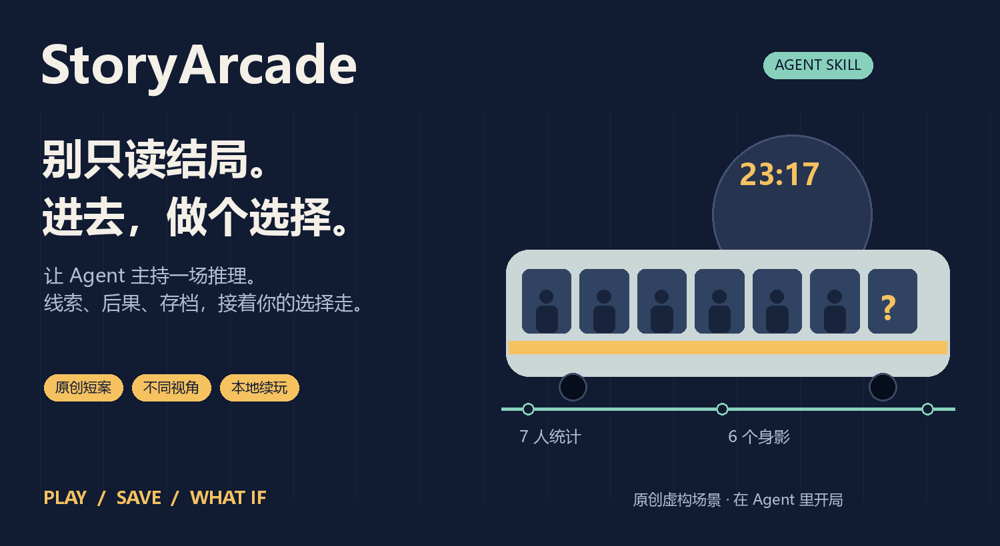
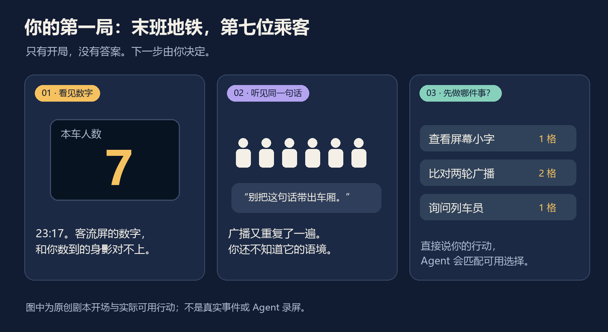
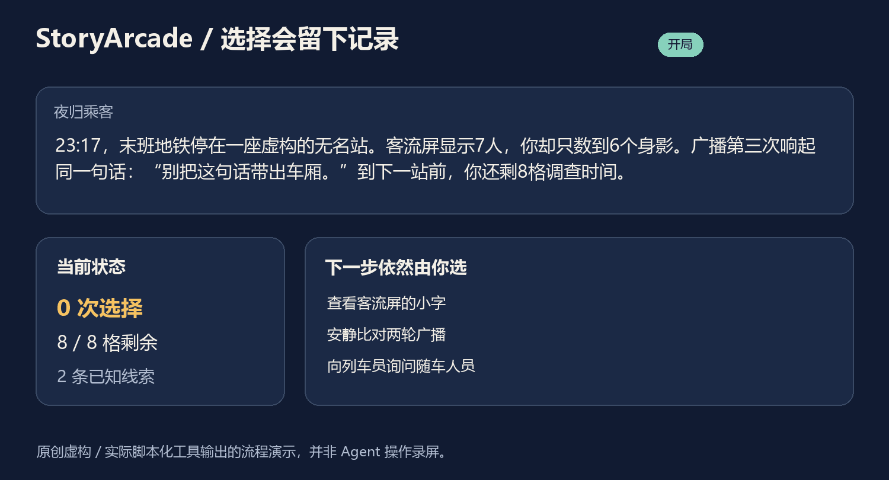
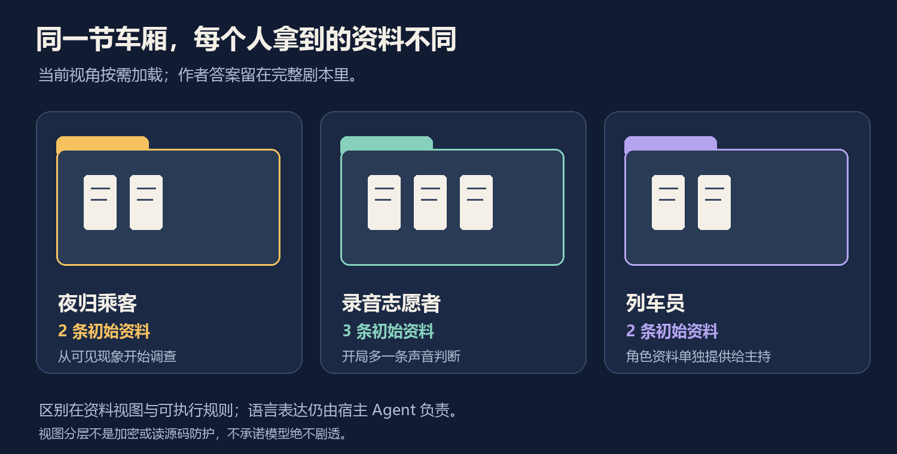
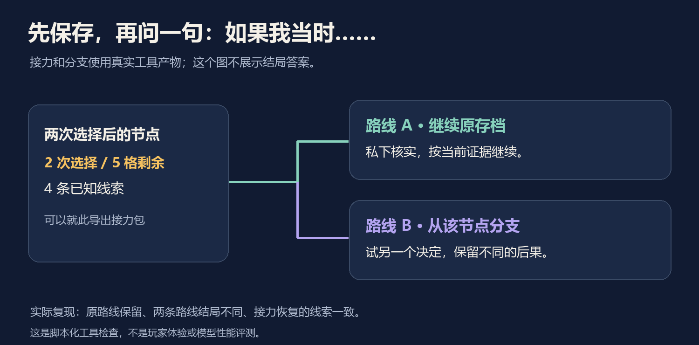

<p align="center"></p>

# StoryArcade 🎟️ 把故事变成一场可参与的推理

**你的 Agent 当主持。你来问、找、判断；线索、选择后果和存档由工具留下。**

可以开一局原创悬疑，换个角色看同一事件，把脑洞改成可玩的短案，或把半途存档交给朋友继续。安装后直接在原来的 Agent 里说话。

[English](README.en.md) · [安装开局](#把它装进你的-agent) · [看真实工具产物](examples/README.md) · [Skill 本体](SKILL.md) · [设计依据](references/design-evidence.md)


## 23:17。屏幕上多出来的那个人，在哪里？

末班地铁停在一座虚构的无名站。你抬头数了一遍：6个身影。客流屏：7人。

广播第三次重复同一句话：**“别把这句话带出车厢。”**

你先看屏幕的小字，还是安静听两轮广播？你会私下问列车员，还是向全车公开征询线索？调查时间有限，选择会留下不同后果。



这是仓库自带的原创短案 **《末班地铁：第七位乘客》**。上图只展示开局和实际可用行动，没有给出答案。想轻松一点，还有 **《雨夜便利店：第十三杯咖啡》**：一份12杯订单，台面却摆着13杯，最后一杯留给谁？

## 把它装进你的 Agent

```sh
npx skills add l422145205-source/story-arcade
```

然后说：

> 用 `$story-arcade` 带我玩《末班地铁》，从乘客视角开始。每次等我行动再推进；在当前工作区保存进度，先别告诉我结局。

需要能读取本地文件、执行 Python 的兼容 Agent。运行工具只用 **Python 3.10+ 标准库**，无需另外部署模型、数据库或申请 API Key。语言理解和叙述使用宿主 Agent 的能力。

## 装了以后，比直接聊天多什么？

| 你想要的体验 | 普通聊天需要另行组织的事 | StoryArcade 已封装 |
| --- | --- | --- |
| 下一次接着玩 | 提供回顾、说明哪些选择已经发生 | 版本绑定的本地事件存档，重放得到当前进度 |
| 角色别突然全知 | 反复区分玩家、NPC和作者知道的内容 | 玩家视图与角色资料分开，按当前知识提供内容 |
| 选择有后果 | 记住资源、信任和已经改变的条件 | 工具执行前置条件、成本、状态变化和结局门槛 |
| “如果刚才选另一边？” | 复制上下文并尽量保持两条路线 | 从指定节点分支，保留原路线 |
| 帮我试试剧本 | 手工检查线索与分支能否到达结局 | 作者侧状态探索和可执行的结局路线 |

普通聊天在给足同等规则、文件和工具后也能做到。**Skill 的价值是把这些流程和工具装好，下一次可以复用。** 它没有增加一个新模型，也不承诺语言模型绝不出错或剧透。



动图来自原创虚构剧本的实际工具输出，是流程演示，**不是 Agent 操作录屏或玩家体验评测**。

## 六种值得试试的玩法与用途

### 🚇 01｜茶歇里，当一回调查者

> “开一局轻悬疑，给我能自己判断的线索，先不要解释答案。”

你用自己的话行动，Agent 匹配当前可用选择。决定性线索只有在行动成功后才写入进度；没问过的人，不会自动算作问过。悬疑氛围由 Agent 主持，规则和后果由工具执行。

当前是有规则的短案，不是无限开放世界。超出已写行动的请求，可以从已知事实回应，或明确扩写新内容；不会假装工具已经记录了不存在的行动。

### 🎭 02｜同一件事，换个人站进去

> “再开一局，这次我当录音志愿者。别沿用上一局乘客的记忆。”

主案提供两种起始视角。志愿者能听出一条声音判断，乘客从可见现象开始；NPC有自己的资料。切换视角会另开存档，保留各自起点。



分层控制的是工具给出的资料；完整开源剧本里仍有作者答案。这不是加密、权限隔离或对抗读源码的防护。

### 📬 03｜朋友来接力，只接到已经发生的部分

> “我先到这里，整理一份朋友能接着玩的包，别把作者答案放进去。”

导出当前视角的回顾、已知线索、可选行动和事件存档。朋友使用相同版本剧本，可以继续这一视角。生成文件不会自动发送消息或上传；你决定分享给谁。

[接力包示例](examples/demo/relay/relay.md)包含两次选择后的线索，属于部分剧透。没有云端同步，下一次需要能访问同一本地存档。

### ↗️ 04｜想换个决定，原来那条路也还在

> “回到第二次选择后，另开一条路线，试试公开征询线索。”

工具重放前两次选择，在新文件里分支。示例实际跑出了两种不同结局，并检查原路线仍保留。改变决定有了具体的起点和记录，不用把原对话覆盖掉。



### ✍️ 05｜把一个脑洞，变成能试玩的短案

> “把我的原创设定改成互动故事：雨夜便利店，多出来一杯已经付款的咖啡。要有线索，也要允许不同选择。”

Agent 帮你整理观察、口述、推断、作者真相和结局前置条件，再生成同一格式的剧本、运行检查。自带便利店案也可当小型创作参考。人物可以说不完整的话，但主持人不能把口述自动写成已证明的事实。

创作可以先做小：一个核心疑问、几条能追踪的线索、真正影响后续的选择。[作者工作方法](references/authoring.md)

### 🧩 06｜给剧情找卡点，而不是只看文笔

> “检查两个视角能不能到所有结局。如果有走不到的分支，给我复现路径和原因。”

作者工具检查引用、条件、资源和可达状态；结束调查前要求的证据，不能靠结束动作自己凭空补齐。搜索有上限，达到上限会报告未完成，不把“没找到”说成“绝不可能”。

图能跑通之后，还要读实际场景、听试玩反馈。**规则成立不等于故事有趣。** [作者侧检查产物，含剧透](examples/demo/author-audit.json)

## 这几个细节，实际跑过了

- 同一事件重试：没有再次扣时间，文件字节不变。
- 半途接力：恢复后进度和已知线索一致。
- 换一条路线：结局不同，原路线保留。
- 两套原创案例：主案两种视角、便利店一种视角，作者检查均完成小型状态图搜索；每个视角都观察到所写结局的路径。
- 陈旧文件、冲突事件ID、未解锁行动：拒绝更新，保留原存档。

[全部示例与验证结果](examples/README.md)。这些证明工具行为，不是模型性能、叙事质量或真人试玩成绩。

<details>
<summary><strong>想先运行工具看看？</strong></summary>

克隆仓库后：

```sh
python -m unittest discover -s tests -v
python tools/reproduce.py --out work/my-demo
```

输出目录须不存在。会实际执行开局、选择、重复事件重试、接力、分支和作者检查，不需要模型或网络。

单独开局：

```sh
python scripts/storyarcade.py new --story assets/last-train.json --role passenger --session work/my.save.json
python scripts/storyarcade.py show --story assets/last-train.json --session work/my.save.json --format md
```

[主持流程](references/hosting.md) · [JSON格式](references/story-format.md) · [示例/图片复现](tools/README.md)

</details>

## 为什么这样设计？

[AI Dungeon 的产品文档](https://help.aidungeon.com/faq/plot-components)把剧情要点和摘要用于维持上下文；[ink](https://www.inklestudios.com/ink/)把可测试的分支纳入写作流程。近期[互动叙事设计研究](https://arxiv.org/abs/2601.18785)区分作者设定与玩家体验，[长期一致性研究](https://arxiv.org/abs/2608.08160)也表明这是需要单独检查的问题。

据此，这个 Skill 选择用明确规则维护决定性事实，保留 Agent 的语言主持能力。它使用自己的小型格式，不是上述产品的插件，也没有复现论文实验。[来源、设计推断与限制](references/design-evidence.md)

## 给下一位玩家留张车票

想试玩，先从一句“带我开局”开始。想贡献，欢迎带一段原创短案或脱敏的行动匹配问题来 [Issues](https://github.com/l422145205-source/story-arcade/issues)：你想怎么行动、当时有哪些选择、哪里让你出戏。

喜欢这个点子，欢迎 **Star** 收藏，把开场图分享给爱推理、写故事或做 Agent 的朋友。MIT 开源；请勿把真实个人信息、私聊或未经授权的素材放进公开案例。
